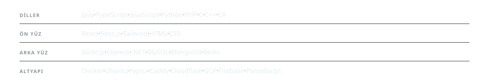

<picture>
  <source media="(prefers-color-scheme: dark)" srcset="assets/header-dark.svg" />
  <source media="(prefers-color-scheme: light)" srcset="assets/header-light.svg" />
  
</picture>

<a href="https://turkishpvp.llc">Site</a> ·
<a href="mailto:sheduxdev@turkishpvp.llc">E-posta</a> ·
<a href="https://github.com/sheduxdev?tab=repositories">Depolar</a>

---

### Ne yapıyorum

Java birincil dilim. Minecraft tarafında tek bir plugin'den network mimarisinin tamamına kadar her
katmanı kuruyorum: özel anticheat, oyun motoru işleri, mikroservisler. Ön yüzden bare metal'e kadar
tek başıma taşıyorum, DevOps ve güvenlik dahil.

Şu an TurkishPvP altyapısını ölçeklendiriyorum.

<picture>
  <source media="(prefers-color-scheme: dark)" srcset="assets/stack-dark.svg" />
  <source media="(prefers-color-scheme: light)" srcset="assets/stack-light.svg" />
  
</picture>

---

### Rakamlar

<picture>
  <source media="(prefers-color-scheme: dark)" srcset="https://raw.githubusercontent.com/sheduxdev/sheduxdev/output/snake-dark.svg" />
  <source media="(prefers-color-scheme: light)" srcset="https://raw.githubusercontent.com/sheduxdev/sheduxdev/output/snake-light.svg" />
  
</picture>