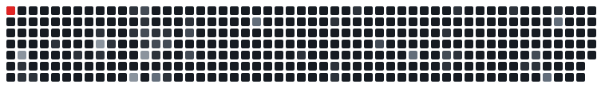

<picture>
  <source media="(prefers-color-scheme: dark)" srcset="assets/header-dark.svg" />
  <source media="(prefers-color-scheme: light)" srcset="assets/header-light.svg" />
  
</picture>

Full stack geliştiriciyim, on yılı aşkın süredir Java ve Minecraft altyapısı kuruyorum.

### Ne yapıyorum

Java birincil dilim. Minecraft tarafında tek bir plugin'den network mimarisinin tamamına kadar her
katmanı kuruyorum: özel anticheat, oyun motoru işleri, mikroservisler. Ön yüzden bare metal'e kadar
tek başıma taşıyorum, DevOps ve güvenlik dahil.

TurkishPvP LLC'nin sahibiyim, şu an altyapısını ölçeklendiriyorum.

<table>
  <tr><td><b>Diller</b></td><td>Java · TypeScript · JavaScript · Python · PHP · C · C++ · C#</td></tr>
  <tr><td><b>Ön yüz</b></td><td>React · Next.js · Tailwind · HTML · CSS</td></tr>
  <tr><td><b>Arka yüz</b></td><td>Node.js · Express · .NET · MySQL · MongoDB · Redis</td></tr>
  <tr><td><b>Altyapı</b></td><td>Docker · Ubuntu · Nginx · Caddy · Cloudflare · GCP · Firebase · Pterodactyl</td></tr>
</table>

### Referanslar

[Tarık Pasha](https://www.youtube.com/@tarikpasha/) ·
[Egoist Pati](https://www.youtube.com/@EgoistPati) ·
[Takla King](https://www.youtube.com/@taklakingg) ·
[Son Oyuncu](http://sonoyuncu.com.tr/) ·
[Baso Network](https://baso.network/) ·
[Refine Development](https://refinedev.org/) ·
[Yusuf Te](https://www.youtube.com/@YusufTe) ·
[Rtrix](http://rtrix.eu/)

<picture>
  <source media="(prefers-color-scheme: dark)" srcset="assets/snake-dark.svg" />
  <source media="(prefers-color-scheme: light)" srcset="assets/snake-light.svg" />
  
</picture>

[turkishpvp.llc](https://turkishpvp.llc) · [denizusta@proton.me](mailto:denizusta@proton.me)
